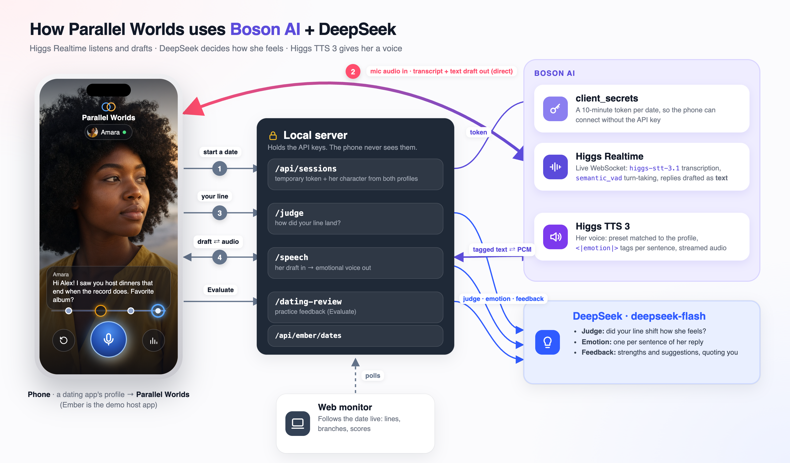
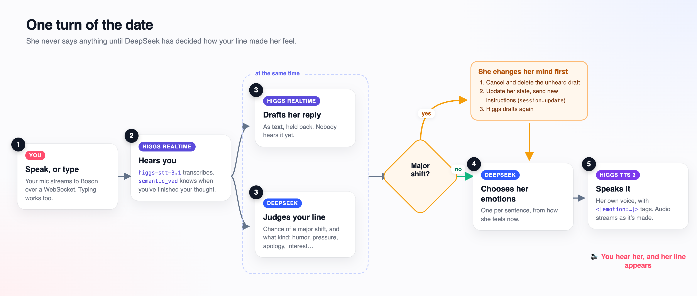
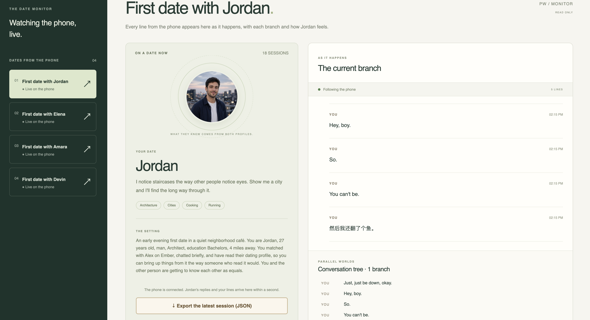

# Parallel Worlds: simulate your first date

**Parallel Worlds is a feature a dating app could add as a plugin or extension: before you meet
a match, simulate your first date with them.** You talk to them by voice. They answer as the
person on their profile, have read yours, and react to how the conversation goes. Every line you
say is a branch point: rewind to any of them and see where a different answer leads. Afterwards,
see how they felt and get feedback on what you said.

To show the feature inside a real app experience, this repository includes **Ember**, a mock
dating app built only as the host. Ember is not the product: its profiles, matches and chats are
demo data. The **Parallel Worlds** button on a profile is the integration point a real dating app
would provide. A web **monitor** shows the simulation from the outside, live, for demos and
analysis.

Built for a Boson AI hackathon to show what the Boson APIs can do together: **Higgs Realtime**
for live speech recognition and dialogue, **Higgs TTS 3** for an expressive voice that matches
the person, and **DeepSeek** as the fast judge that decides how the person reacts. See
[How we use Boson AI and DeepSeek](#how-we-use-boson-ai-and-deepseek).

## Contents

- [How we use Boson AI and DeepSeek](#how-we-use-boson-ai-and-deepseek)
- [Quick start](#quick-start)
- [Use it on an iPhone](#use-it-on-an-iphone)
- [How to use it](#how-to-use-it)
- [The web monitor](#the-web-monitor)
- [Configuration](#configuration)
- [How it works](#how-it-works)
- [Project layout](#project-layout)
- [HTTP API](#http-api)
- [Development](#development)
- [Privacy and security](#privacy-and-security)
- [Troubleshooting](#troubleshooting)
- [Further documentation](#further-documentation)

## How we use Boson AI and DeepSeek

Three models each do the job they are best at. **Higgs Realtime** listens and writes the reply,
**DeepSeek** decides how the person feels about what you just said, and **Higgs TTS 3** speaks
the reply with matching emotion and a voice that fits the profile.



### One turn, step by step



### What each API does

| API | Used for | How | Code |
| --- | --- | --- | --- |
| **Boson `client_secrets`** | Keeping the API key off the phone | The server mints a 10-minute token for each session; the browser connects to Realtime with it | `server/higgs.ts` |
| **Boson Higgs Realtime** | Listening, transcription and drafting replies | WebSocket to `higgs-realtime`: `higgs-stt-3.1` transcription, `semantic_vad` turn detection, `output_modalities: ["text"]`. Her character is in `session.update` instructions | `src/realtime/HiggsClient.ts` |
| | Rewinding | A new session replays the heard dialogue as `conversation.item.create` text items before you speak again | `shared/tree.ts` |
| | Her speaking first | `response.create` with no user turn, when the profile is outgoing | `src/realtime/HiggsClient.ts` |
| | Changing her mind mid-turn | `response.cancel` and `conversation.item.delete` discard a draft nobody heard; `session.update` applies her new state | `src/realtime/HiggsClient.ts` |
| **Boson Higgs TTS 3** | Her voice | `POST /v1/audio/speech`, streamed PCM 24 kHz. A preset voice per profile matched to gender (`chloe`, `nora`, `eleanor`, `oliver`, `marcus`, `jake`). Inline `<\|emotion:…\|>`, `<\|prosody:expressive_high\|>` and `<\|reset\|>` tags per sentence | `server/speech.ts`, `server/adaptation/coordinator.ts` |
| **DeepSeek** (`deepseek-flash`, JSON mode) | Judging each line | Probability of a major shift and the kind of event. It nudges her relationship scores; a major shift triggers a full appraisal and new instructions before she answers | `server/adaptation/decisions.ts` |
| | Voice emotion | One emotion per sentence of her reply, from her current feelings | `server/adaptation/decisions.ts` |
| | Full appraisal (optional) | Evidence-linked state update on major shifts (`APPRAISAL_PROVIDER=deepseek`) | `server/adaptation/providers.ts` |
| | Practice feedback | A strength and up to three suggestions, each quoting one of your lines, checked before display | `server/datingReview.ts` |

### Why this design

- **Text first, voice second.** Realtime could speak directly, but drafting in text lets us
  hold her reply for the few hundred milliseconds DeepSeek needs. If your line changed how she
  feels, the draft is thrown away before anyone hears it, and she answers from her new state.
- **Emotion where it is heard.** TTS 3 takes inline emotion and prosody tags, so each sentence
  can sound amused, hesitant or annoyed according to DeepSeek, and the voice fits the profile.
- **Branching is cheap.** Rewinding only needs a fresh Realtime session seeded with text, so you
  can try many versions of the same moment. Her state is restored from the server's checkpoint.
- **Keys stay home.** Permanent Boson and DeepSeek keys never leave the server; the phone only
  ever holds a short-lived Realtime token.

## Quick start

Requirements: **Node.js 22.12+** (24 LTS recommended), **pnpm 10+**, a
[Boson AI API key](https://boson.ai), and a DeepSeek API key for judging and feedback
(optional: without it, simple offline keyword rules are used).

```bash
git clone https://github.com/TICO279/Parallel-Worlds.git
cd Parallel-Worlds
git checkout main2      # the Ember phone app lives on main2 until it is merged into main
pnpm install
cp .env.example .env    # then fill in BOSON_API_KEY and DEEPSEEK_API_KEY
pnpm dev
```

| Page | Address |
| --- | --- |
| **Ember, the phone app** | http://127.0.0.1:5173/ |
| **Monitor** (watch the date live) | http://127.0.0.1:5173/practice/ |
| Developer lab with the built-in character Alex | http://127.0.0.1:5173/practice/?lab |

Check the key with `curl http://127.0.0.1:5173/api/health`: `credentialsConfigured` should be
`true`. After editing `.env`, stop `pnpm dev` (Ctrl+C) and start it again.

On a computer, Ember is drawn inside a phone frame, so you can try everything in a desktop
browser; `127.0.0.1` is allowed to use the microphone without HTTPS. Use headphones so her voice
does not reach your microphone.

## Use it on an iPhone

Safari only allows the microphone on HTTPS pages, so give your computer a temporary HTTPS address
with a free Cloudflare quick tunnel:

```bash
brew install cloudflared                                   # once
cloudflared tunnel --url http://127.0.0.1:5173 2>&1 | grep --line-buffered -o 'https://[a-z0-9-]*\.trycloudflare\.com'
```

1. Keep `pnpm dev` and the tunnel running, and keep the computer awake.
2. On the iPhone, open the printed `https://….trycloudflare.com` address in **Safari**.
3. Optional: **Share → Add to Home Screen** to open Ember full screen like an app.
4. Allow the microphone when iOS asks.
5. Watch on the computer at http://127.0.0.1:5173/practice/.

The address changes every time the tunnel starts, and the phone treats each address as a new
site (a fresh profile). **Anyone with the address can use your API credit**, so do not share it
and stop the tunnel (Ctrl+C) when you are done.

## How to use it

1. **My profile** (the avatar tab): fill in who you are and **Save profile**. Your date reads it.
2. **Discover**: tap a card to open her profile. **✕** passes, **♥** likes (every like is a
   match), and the **Parallel Worlds** orb starts a simulated first date. On the **It's a Match**
   screen you can send a message, **Simulate our first date**, or keep swiping.
3. **The date**: tap the mic and talk, or type in the box. Outgoing partners speak first about
   something on your profile; reserved ones wait for you.
4. **Change direction**: each thing you say is a dot on the timeline. Tap a dot, then speak, type
   or tap it again to go back to just before that line and continue differently. **Undo** goes
   back one line. The earlier branch is kept.
5. **Evaluate**: her feelings so far (comfort, trust, interest, respect, closeness), and
   practice feedback that quotes your lines. From feedback you can jump to a line or retry it.
6. **Messages → Your first dates**: reopen any date where you left off. Chats with matches are
   here too.
7. **Monitor** (`/practice/` on the computer): follows the date live. See
   [The web monitor](#the-web-monitor).

**Fresh start:** restarting the app (`pnpm dev`) forgets every conversation, on the server and on
the phone (dates, matches and chats). Your profile stays.

## The web monitor

While you are on the date on the phone, the web page at `/practice/` follows it live from the
computer: useful for demos, for a coach or friend watching along, and for analysing a
conversation afterwards. It is read-only; the phone does the talking.



- **Dates from the phone** (left): everyone you have had a simulated date with, newest first,
  with **● Live on the phone** while that date is connected. The page follows the date in
  progress; click another date to look at it, and **↻ Follow the phone** to go back.
- **Your date** (middle): their photo, profile and the setting the character was given, which
  combines their profile with yours.
- **The current branch** (right): every line as it arrives, usually within a second, with ★ on
  lines that shifted how they feel and a note on replies you interrupted.
- **Conversation tree**: all branches, including the ones you left by rewinding.
- **Character scores** (below): comfort, trust, interest, respect and closeness, mood, the last
  judgment, voice emotions and timing, for the newest session.
- **Export the latest session** downloads it as JSON.

The monitor reads from the server (`GET /api/ember/dates`, every second), so it works the same
when the date runs on a real iPhone through the tunnel. It shows dates since the last server
start.

## Configuration

Copy `.env.example` to `.env`. Only the first two matter for normal use:

| Variable | Purpose |
| --- | --- |
| `BOSON_API_KEY` | **Required.** Realtime sessions and text-to-speech. |
| `DEEPSEEK_API_KEY` | Recommended. Judges each line, picks voice emotions, writes feedback. |
| `APPRAISAL_PROVIDER` | `mock` (default, offline rules) or `deepseek` for full model appraisal on major shifts. |
| `TTS_VOICE` | Voice for the built-in lab character. Ember partners use a voice matching their gender. |
| Everything else | Timeouts, thresholds and model names; the defaults in `.env.example` are tested. |

Never prefix keys with `VITE_`: keys stay on the server and are never sent to the browser.

## How it works

- **One date, many sessions.** Each connection is a fresh Boson Realtime session. The browser
  gets a 10-minute temporary token from the local server and streams audio directly to Boson.
  The local server never sees or stores audio.
- **Text first, then voice.** See [One turn, step by step](#one-turn-step-by-step).
- **Who she is.** `shared/partner.ts` builds her character from her profile and yours. Her
  feelings live in a versioned state (`server/adaptation/`): slow relationship indicators that
  every line nudges, plus a full appraisal on major shifts.
- **Branching.** The phone keeps a conversation tree per partner (`shared/tree.ts`, browser
  storage). Rewinding starts a new session that replays the heard dialogue up to that point as
  text, and restores her state from the server's checkpoint when it is still available.
  Interrupted lines are not replayed, because you may not have heard all of them.
- **The monitor** rebuilds each partner's tree from the server's sessions
  (`GET /api/ember/dates`) and polls every second, so it also follows a real iPhone.
- **Memory only.** Sessions live in server memory. Each server start has a new boot id, and
  the phone erases its conversations when it sees a new one (`src/freshStart.ts`).

## Project layout

| Path | What it is |
| --- | --- |
| `dating/` | Ember: the static phone dating app (Discover, Messages, My profile) and photos |
| `src/PhoneDate.tsx`, `src/phone.css` | The first date screen: timeline, rewind, mic, typing, Evaluate |
| `src/DatingReview.tsx` | Practice feedback in the Evaluate sheet |
| `src/Monitor.tsx`, `src/monitorData.ts` | The web monitor |
| `src/realtime/HiggsClient.ts` | Realtime socket, turn pipeline (draft → judge → speak), opening turn, interruptions |
| `src/audio/` | Microphone capture, resampling and PCM playback (AudioWorklets) |
| `src/App.tsx` | Developer lab with Alex (`/practice/?lab`), used by tests and evaluation tools |
| `shared/` | Partner scenarios, domain types, transcript reconciliation, conversation tree |
| `server/app.ts` | Local HTTP API; serves the built pages in production |
| `server/adaptation/` | Judge, appraisal providers, character state engine and coordination |
| `server/speech.ts`, `server/datingReview.ts` | Higgs TTS 3 streaming; DeepSeek practice feedback |
| `server/orchestrator.ts` | Built-in characters and prompt construction |
| `tools/` | Live probes and evaluation scripts (`pnpm probe`, `pnpm evaluate:*`) |
| `test/` | Automated tests (Vitest) |
| `docs/` | Design notes, evaluation reports and results ([index](docs/README.md)) |

## HTTP API

The API listens on `127.0.0.1:3000`; in development Vite forwards `/api` from port 5173. It only
accepts requests from the local pages (ports 3000, 5173, 5174) and from a same-origin HTTPS
`trycloudflare.com` tunnel. All responses are `Cache-Control: no-store`.

| Method and route | Purpose |
| --- | --- |
| `GET /api/health` | Server up, key configured, boot id |
| `GET /api/scenarios` | Built-in characters (lab) |
| `GET /api/ember/dates` | Ember dates grouped by partner, with every session (monitor) |
| `POST /api/sessions` | Start a session: `{ scenarioId: 'ember-date', partner, user, history }` → session, Higgs config, temporary token |
| `GET /api/sessions/:id` | One session with its turns |
| `PATCH /api/sessions/:id` | Lifecycle: connecting, active, closed |
| `PUT /api/sessions/:id/conversation` | Save a transcript snapshot |
| `POST /api/sessions/:id/judge` | Judge your line: ordinary, or a major shift with new instructions |
| `POST /api/sessions/:id/speech` | Voice her reply: per-sentence emotions, streamed PCM 24 kHz |
| `GET /api/sessions/:id/adaptation` | Her state, scores, judgments and current instructions |
| `POST /api/sessions/:id/adaptation/application` | Record when new instructions were applied |
| `POST /api/sessions/:id/latencies` | Timing measurements |
| `POST /api/sessions/:id/appraisals` | Request a full appraisal (scripts) |
| `POST /api/dating-review` | Practice feedback on the current conversation path |
| `GET /api/sessions/:id/export` | Download a session as JSON (no credentials) |

## Development

```bash
pnpm dev         # API (tsx watch, restarts on server changes) + Vite on 5173
pnpm test        # automated tests
pnpm typecheck
pnpm build       # typecheck + production build into dist/
pnpm start       # production: Ember at :3000/, monitor at :3000/practice/ (run pnpm build first)
pnpm probe       # live Boson connectivity check with a short text exchange
```

Port 5173 is strict: Vite stops instead of moving to another port. Note that `pnpm dev`
restarts the API whenever a server file changes, which also gives the phone a fresh start.

## Privacy and security

- The permanent API keys stay in `.env` on your computer. Browsers only receive a temporary
  Boson token per connection, and tokens never enter logs, the session store or exports.
- Audio goes directly from the browser to Boson; transcripts are kept in server memory only and
  are gone after a restart. The phone keeps its own copy in browser storage.
- This is a single-user local application, not a hosted service. A tunnel makes it reachable
  from the internet: share the address with no one.

## Troubleshooting

| Symptom | What to do |
| --- | --- |
| `credentialsConfigured: false` | Fill in `BOSON_API_KEY` in `.env`, then restart `pnpm dev`. |
| "Only the local application can use this API" | Open the app on 127.0.0.1 or localhost port 5173 (or through the tunnel). |
| No microphone prompt on iPhone | Use Safari with the `https://` tunnel address; check Settings → Safari → Microphone. |
| Tunnel address shows Cloudflare error 1033 | The tunnel stopped. Start it again and use the new address. |
| Her voice triggers the mic | Use headphones. |
| Monitor shows nothing | Start a date on the phone; the monitor only knows dates since the last server start. |
| Old dates gone | Expected after a restart: every start is a fresh start. |
| Port 5173 or 3000 in use | Stop the other copy of the app. |

## Further documentation

See the [documentation index](docs/README.md): the mobile feedback flow, the adaptive character
design, branching and score behavior, realism evaluation and experiment results.

Parts of the realtime client are adapted from the
[official Boson tutorial](https://github.com/boson-ai/Higgs-Realtime-Tutorial/tree/87f1ae81434d8a65126503ceef36871e0b529f5c).
See the [attribution](third-party/NOTICE.md) and its [Apache 2.0 license](third-party/BOSON-LICENSE).
